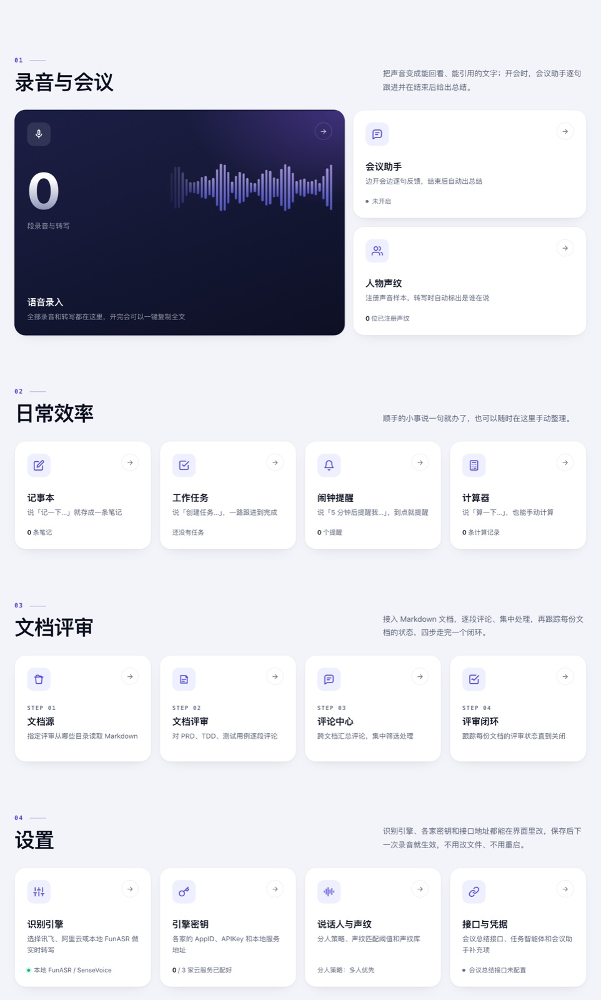
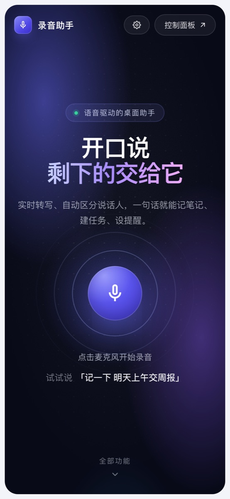
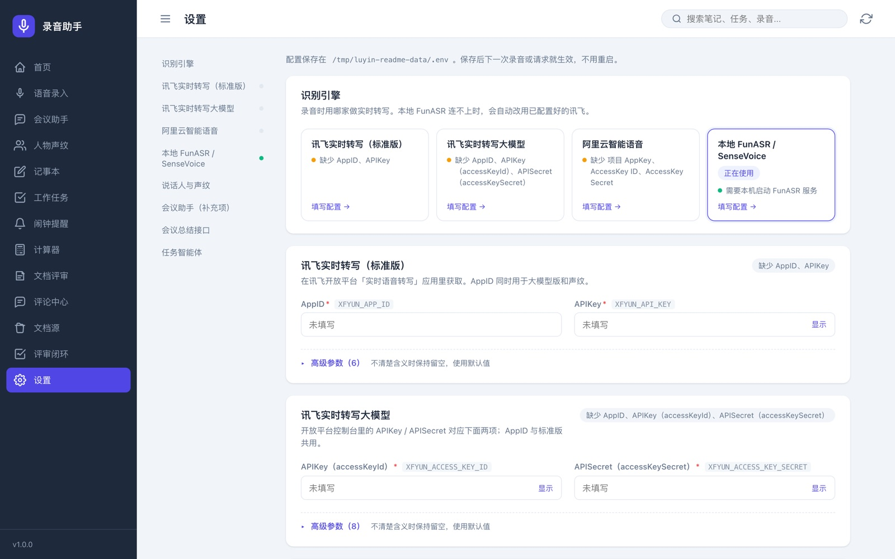

<div align="center">


# 录音助手 luyin

**开口说，剩下的交给它。**

语音驱动的桌面助手：实时转写并区分说话人，一句话就能记笔记、建任务、设提醒。<br>
支持讯飞、阿里云和本地 FunASR 多种识别引擎，可作为 macOS 桌面应用或纯 Web 使用。

[English](README_EN.md) · [快速开始](#快速开始) · [配置识别引擎](#配置识别引擎) · [语音指令](#语音指令)

[](https://github.com/jingjingliu927/luyin/actions/workflows/test.yml)


</div>

## 功能

**录音与会议**
- **实时转写**：边说边出字，支持讯飞实时转写（标准版 / 大模型）、阿里云智能语音、本地 FunASR / SenseVoice 四种引擎；本地服务连不上时自动切到已配置的云端引擎。
- **说话人区分**：讯飞角色分离 + 本地匿名分人兜底，转写时可以直接给「说话人 1」标注真名。
- **声纹识别**：注册一段声音样本，之后自动认出是谁在说（讯飞声纹 1:N 搜索）。
- **会议助手**（可选）：录音时把每句话发给你配置的智能体逐句反馈，结束后自动生成会议总结。
- **离线兜底**：实时链路不可用时，自动改为分段录音 + 本地 Whisper 转写。

**一句话办小事**
- 记笔记、建任务 / Bug、定时提醒、番茄钟专注、四则运算，全部用语音完成，也能在控制面板里手动管理。

**文档评审**
- 接入本地 Markdown 目录，逐段评论、对比版本、集中处理评论、跟踪每份文档的评审状态。评论单独存储，不会改写原文。

**设置**
- 识别引擎、各家密钥、接口地址都能在界面里改，保存即写回 `.env`，下一次录音生效，不用重启。密钥只显示打码串。

**桌面版额外支持**：悬浮球、菜单栏托盘、截图、系统通知、闹钟弹窗。

<table>
  <tr>
    <td width="62%"></td>
    <td></td>
  </tr>
  <tr>
    <td colspan="2"></td>
  </tr>
</table>

## 快速开始

需要 Node.js 20 或更高版本。

```bash
git clone https://github.com/jingjingliu927/luyin.git luyin
cd luyin/code
npm install
npm run web        # Web 版：打开 http://localhost:3456
```

第一次打开后，进入右上角「设置」选择识别引擎并填写密钥即可开始录音；也可以先把根目录的 `.env.example` 复制成 `.env` 再填写。

> 浏览器只在 `localhost` 或 HTTPS 页面下允许使用麦克风。用 `npm run web:lan` 在局域网打开时，其它设备上的录音可能被浏览器拦截。

### 桌面版（macOS）

```bash
cd code
npm start          # 开发运行：悬浮球 + 控制面板
npm run build      # 打包 dmg，产物在 code/dist/
```

打包默认不做签名公证；要分发给别人，请在 `package.json` 的 `build.mac` 里配置你自己的 Apple 开发者证书并打开 `notarize`。

## 配置识别引擎

所有配置都可以在「设置」页里完成，下表是对应的环境变量（完整列表见 [`.env.example`](.env.example)）。

| 引擎 | `ASR_PROVIDER` | 必填项 | 说明 |
|---|---|---|---|
| 讯飞实时转写（标准版） | `xfyun` | `XFYUN_APP_ID`、`XFYUN_API_KEY` | [讯飞开放平台](https://www.xfyun.cn/) 实时语音转写 |
| 讯飞实时转写大模型 | `xfyun_llm` | `XFYUN_APP_ID`、`XFYUN_ACCESS_KEY_ID`、`XFYUN_ACCESS_KEY_SECRET` | 支持方言自动识别、声纹匹配 |
| 阿里云智能语音 | `aliyun` | `ASR_APP_KEY`、`ALIBABA_CLOUD_ACCESS_KEY_ID`、`ALIBABA_CLOUD_ACCESS_KEY_SECRET` | [智能语音交互](https://www.aliyun.com/product/nls) 实时识别 |
| 本地 FunASR / SenseVoice | `funasr` | 无（默认连 `ws://127.0.0.1:10095`） | 免费、离线，需要先启动本地服务，见下文 |

### 本地 FunASR 服务

`tools/funasr/` 里是一个可直接运行的 WebSocket 识别服务（基于 [FunASR](https://github.com/modelscope/FunASR) 官方示例修改），默认用 CPU、不启用 SSL：

```bash
cd tools/funasr
python -m venv .venv && source .venv/bin/activate
pip install -r requirements.txt       # torch 请按自己的平台安装
python funasr_wss_server.py           # 首次运行会自动下载模型
# 有 NVIDIA 显卡：python funasr_wss_server.py --device cuda --ngpu 1
```

### 本地 Whisper 兜底（可选）

实时链路连不上时会改用本地 [faster-whisper](https://github.com/SYSTRAN/faster-whisper) 分段转写，需要 `pip install faster-whisper`。模型默认 `small`，可用环境变量 `WHISPER_MODEL` 修改；国内网络默认走 `hf-mirror.com` 下载。

### 可选集成

- **会议助手**：在「会议助手」页填写 AppCode、AppSecret、AgentMatchFlowPath 后开启，对接 Kaleido / Bach 超级智能体。
- **会议总结接口**：配置 `MEETING_SUMMARY_API_URL` 后，「语音录入」里可以生成会议纪要。
- **任务智能体**：配置 `KALEIDO_TASK_AGENT_URL`、`KALEIDO_APP_CODE`、`KALEIDO_APP_SECRET` 后，「创建任务」会同时交给智能体处理；不配置时只在本地建任务。

## 语音指令

点麦克风（或按空格）开始录音后，直接说：

| 你说 | 效果 |
|---|---|
| 记一下 明天上午交周报 | 新建一条笔记 |
| 创建任务 整理会议纪要 / 提个 bug 登录页闪退 | 新建任务 / Bug |
| 完成任务 周报 | 把匹配的任务标记为完成 |
| 10 分钟后提醒我开会 / 半小时后叫我 | 定时提醒 |
| 专注 25 分钟 | 番茄钟 |
| 算一下 128 乘以 3 / 3 的平方是多少 | 计算并记录历史 |
| 截图 | 截屏（桌面版） |
| 打开面板 | 打开控制面板 |

其它内容都会作为普通转写保存到「语音录入」。

## 项目结构

```
.
├── code/                    # Node.js 工程（Electron + Express）
│   ├── main.js              # Electron 主进程：悬浮球、托盘、截图、通知
│   ├── public/              # 前端（原生 HTML/CSS/JS）
│   │   ├── index.html       # 浏览器首页；在桌面版里是悬浮球
│   │   ├── dashboard.html   # 控制面板
│   │   └── js/app.js
│   └── server/
│       ├── index.js         # HTTP 接口与语音指令执行
│       ├── ws-server.js     # 实时识别 WebSocket，多引擎调度与说话人处理
│       ├── asr-stream*.js   # 各识别引擎的流式客户端
│       ├── command-router.js# 语音指令解析
│       ├── env-settings.js  # 「设置」页读写 .env
│       ├── doc-review.js    # 文档评审
│       └── *.test.js        # node:test 测试
├── tools/funasr/            # 本地 FunASR 识别服务
├── docs/screenshots/
└── .env.example
```

## 数据存放

所有数据都只保存在本机：

- **Web 版**：`code/data/`（笔记、任务、提醒、声纹登记、评审评论等 JSON）和 `code/recordings/`（录音与转写），配置在仓库根目录 `.env`。
- **桌面版**：Electron 的应用数据目录（打包后的 macOS 版为 `~/Library/Application Support/录音助手/`），配置也在这个目录下的 `.env`。

这些目录已在 `.gitignore` 里，不会被提交。

## 开发与测试

```bash
cd code
npm test           # node:test，约 160 个用例，不需要任何密钥
```

GitHub Actions 会在每次提交时自动运行测试。

## 安全提示

服务没有登录鉴权，任何能访问端口的人都可以读取记录、修改配置（密钥不会明文返回）。请只在本机或可信局域网中使用，不要直接暴露到公网。

## 致谢

- [FunASR](https://github.com/modelscope/FunASR)：本地语音识别
- [faster-whisper](https://github.com/SYSTRAN/faster-whisper)：离线兜底转写
- [Recorder](https://github.com/xiangyuecn/Recorder)：浏览器录音
- 讯飞开放平台、阿里云智能语音交互

## License

[MIT](LICENSE)
