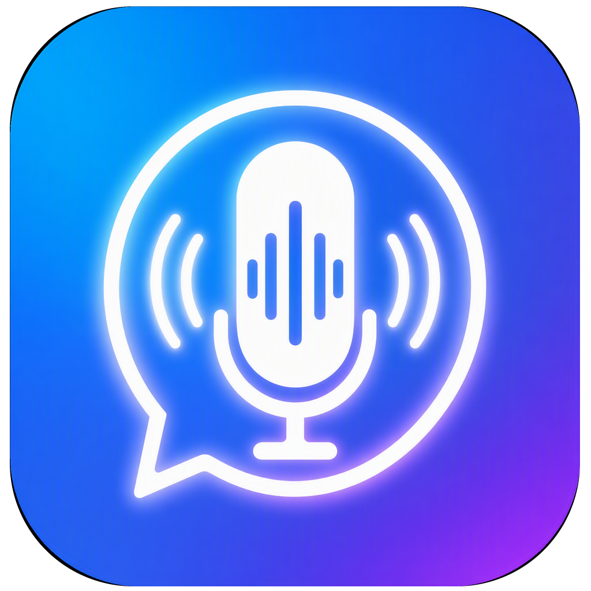
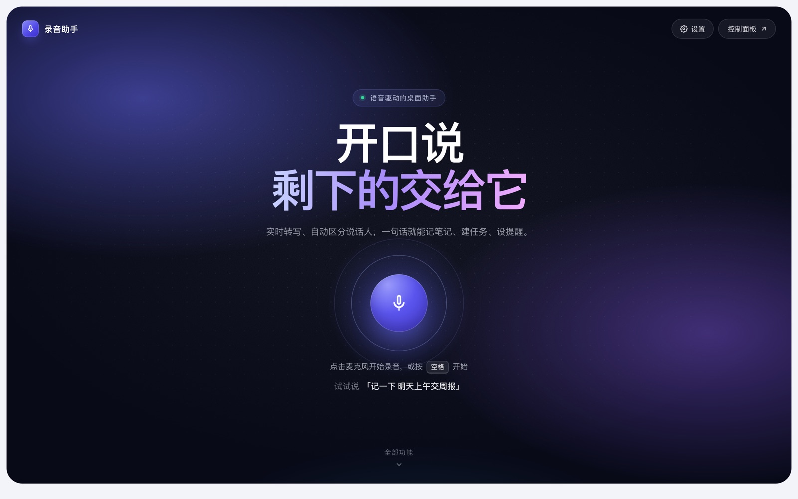

<div align="center">



# luyin · Voice Desktop Assistant

**Just speak. It handles the rest.**

A voice-driven desktop assistant: real-time transcription with speaker separation, and one sentence is enough to take a note, create a task or set a reminder.<br>
Works with iFLYTEK, Alibaba Cloud or a local FunASR server; runs as a macOS desktop app or in the browser.

[中文](README.md)



</div>

> The UI and voice commands are in Chinese (Mandarin).

## Features

- **Real-time transcription** with four engines: iFLYTEK real-time ASR (standard / LLM), Alibaba Cloud NLS, and local FunASR / SenseVoice. Falls back to a configured cloud engine when the local server is down, and to local faster-whisper when streaming is unavailable.
- **Speaker separation** (iFLYTEK role separation plus a local anonymous diarizer) and **voiceprint identification** (iFLYTEK 1:N search). Label "Speaker 1" with a real name while recording.
- **Meeting assistant** (optional): stream each sentence to an agent for live feedback and get a summary when the meeting ends.
- **Voice commands**: notes, tasks / bugs, timed reminders, pomodoro, arithmetic, screenshots, opening the dashboard.
- **Document review**: comment on local Markdown files paragraph by paragraph, compare versions and track review status. Comments are stored separately; source files are never rewritten.
- **Settings UI**: pick the engine and fill in keys in the browser. Changes are written back to `.env` and take effect on the next recording without a restart. Secrets are only shown masked.
- **Desktop extras**: floating mic button, menu-bar tray, screenshots, system notifications.

## Quick start

Requires Node.js 20+.

```bash
git clone https://github.com/jingjingliu927/luyin.git luyin
cd luyin/code
npm install
npm run web        # open http://localhost:3456
```

Open **Settings** (top right) to choose an engine and enter its keys, or copy `.env.example` to `.env` in the repository root.

Desktop app (macOS): `npm start` to run, `npm run build` to package a dmg into `code/dist/` (unsigned by default).

| Engine | `ASR_PROVIDER` | Required |
|---|---|---|
| iFLYTEK real-time ASR | `xfyun` | `XFYUN_APP_ID`, `XFYUN_API_KEY` |
| iFLYTEK real-time ASR (LLM) | `xfyun_llm` | `XFYUN_APP_ID`, `XFYUN_ACCESS_KEY_ID`, `XFYUN_ACCESS_KEY_SECRET` |
| Alibaba Cloud NLS | `aliyun` | `ASR_APP_KEY`, `ALIBABA_CLOUD_ACCESS_KEY_ID`, `ALIBABA_CLOUD_ACCESS_KEY_SECRET` |
| Local FunASR / SenseVoice | `funasr` | none (connects to `ws://127.0.0.1:10095`) |

To run the local FunASR server:

```bash
cd tools/funasr
pip install -r requirements.txt   # install torch for your platform first
python funasr_wss_server.py       # CPU, plain ws:// ; add --device cuda --ngpu 1 for GPU
```

## Data & security

Everything stays on your machine: `code/data/` and `code/recordings/` for the web version, Electron's userData directory for the desktop app. The server has **no authentication**, so only run it on localhost or a trusted LAN.

## Tests

```bash
cd code && npm test
```

## License

[MIT](LICENSE)
